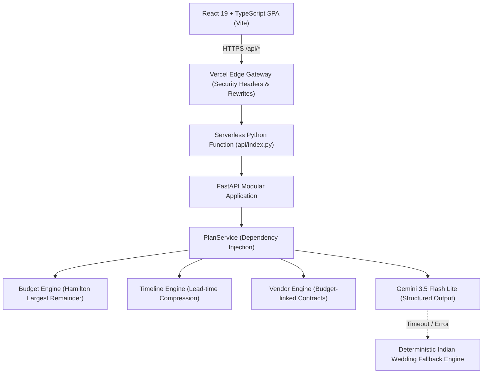

# WedPlan AI

[](https://github.com/Shreyash463/WedPlan-AI/actions/workflows/ci.yml)
[](https://wed-plan-ai-six.vercel.app)
[](https://python.org)
[](https://fastapi.tiangolo.com)
[](https://react.dev)
[](https://www.typescriptlang.org)
[](LICENSE)
[](docs/ACCESSIBILITY.md)

**WedPlan AI** is an intelligent celebration and event planning assistant tailored for Indian weddings. It combines a mathematically rigorous deterministic planning engine with Google Gemini GenAI to generate culturally attuned budgets, countdown timeline roadmaps, vendor procurement checklists, and personalized event concepts.

**Live Application URL**: [https://wed-plan-ai-six.vercel.app](https://wed-plan-ai-six.vercel.app)

---

## 1. System Architecture



---

## 2. Core Capabilities & Problem Statement Alignment

| Challenge Dimension | Architecture Implementation | Key Guarantees |
| :--- | :--- | :--- |
| **Budget Planning & What-If Simulator** | `backend/app/engine/budget.py`<br>`frontend/src/features/budget/` | Uses the **Hamilton Largest Remainder Method** to guarantee category allocations sum exactly to the total budget with zero rupee rounding errors. Real-time debounced recalculation runs locally with 0 LLM latency. |
| **Countdown Timelines** | `backend/app/engine/timeline.py`<br>`frontend/src/features/timeline/` | Backward counts from wedding date. Automatically triggers lead-time compression for short-notice weddings (<90 or <=14 days). Tasks grouped by canonical phases. |
| **Vendor Procurement & Checklists** | `backend/app/engine/vendors.py`<br>`frontend/src/features/vendors/` | Dynamically filtered by chosen functions. Automatically evaluates overdue/urgent status based on real-time date math. Includes contract clauses and advance payment benchmarks. |
| **Personalized Celebration Ideas** | `backend/app/ai/ideas.py`<br>`frontend/src/features/ideas/` | Single structured Gemini 3.5 Flash Lite call with strict JSON schema. Guaranteed zero premium/luxury terms on tight budgets. Robust instant offline fallback. |
| **Smart Dynamic Assistant** | `frontend/src/features/overview/`<br>`backend/app/routes/plan.py` | Interactive intake form with live Indian word conversion, per-guest math, overdue vendor badges, and real-time smart alerts. |

---

## 3. Quickstart & Local Development

### Prerequisites
- Python 3.12 or 3.13
- Node.js 18+ and npm
- Google Gemini API key (optional for offline mode, fallback engine runs automatically)

### Backend Setup
```bash
# 1. Create and activate a virtual environment
python -m venv .venv
# Windows:
.venv\Scripts\activate
# Linux/macOS:
source .venv/bin/activate

# 2. Install dependencies
pip install -r requirements.txt
pip install pytest pytest-asyncio pytest-cov hypothesis ruff mypy httpx

# 3. Configure environment
cp .env.example .env
# Add GEMINI_API_KEY in .env

# 4. Start local development server
uvicorn api.index:app --reload --port 8000
```

### Frontend Setup
```bash
cd frontend
npm install
npm run dev
# App opens at http://localhost:5173
```

---

## 4. Verification & Testing Gates

WedPlan AI enforces strict multi-layer static analysis and automated testing:

```bash
# Static Analysis & Type Checking
python -m ruff check backend api
python -m mypy backend/app api
npm --prefix frontend run check

# Backend Tests (54 unit tests + property-based invariants + >=90% branch coverage)
python -m pytest backend/tests

# Hypothesis Invariant Testing (160 property-based random generation iterations)
python -m pytest backend/tests/test_hypothesis_invariants.py

# Frontend Tests (89 Vitest tests including Axe-Core automated WCAG AA audit)
npm --prefix frontend test

# Faithfully simulate Vercel serverless cold-start and API execution
python scripts/simulate_vercel.py
```

---

## 5. Security & Accessibility

- **Zero Secret Leakage**: `GEMINI_API_KEY` never sent to client, never logged, isolated in serverless runtime.
- **Hardened HTTP Headers**: HSTS (`max-age=63072000`), COOP, CORP, strict CSP, `nosniff`, `frame-ancestors 'none'`.
- **DoS & Payload Defense**: Sliding window IP rate limiter and 1 MB payload size limit middleware.
- **Prompt Injection Defense**: Sanitized user inputs isolated in delimited `<user_context>` XML blocks with explicit system rules.
- **Zero Axe-Core Violations**: Full accessibility compliance across all 5 tab panels and intake form.
- **Accessible Data Visualizations**: Donut chart backed by hidden HTML table (`<caption>`, `<th scope="col">`) for screen readers.

For deep-dive technical reports, see:
- [Architecture & Algorithms](docs/ARCHITECTURE.md)
- [API Specification](docs/API.md)
- [Accessibility & Contrast Audit](docs/ACCESSIBILITY.md)
- [Security Policy & Threat Model](SECURITY.md)
- [Contribution Guidelines](CONTRIBUTING.md)
