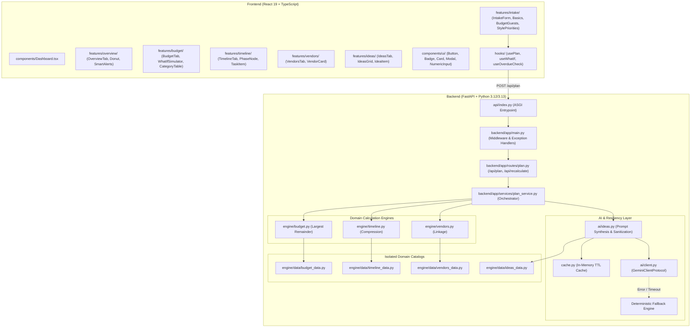

# Architecture & Algorithms Specification

This document provides a comprehensive technical overview of the **WedPlan AI** system architecture, domain catalog modularization, mathematical algorithms, and resilient GenAI orchestration.

---

## 1. High-Level Architecture Overview

WedPlan AI adopts a decoupled, feature-driven architecture consisting of:
1. **Frontend**: React 19 single-page application built with TypeScript and Vite. Modularized into feature directories (`intake`, `overview`, `budget`, `timeline`, `vendors`, `ideas`, `print`, `dashboard`), self-contained UI primitives (`components/ui/`), and custom hooks.
2. **Backend**: FastAPI modular application powered by Pydantic v2 validation. Business logic is isolated in pure engine modules (`backend/app/engine/`) and domain catalogs (`backend/app/engine/data/`), coordinated by `PlanService` via dependency injection.
3. **GenAI Layer**: Google Gemini API client (`google-genai` SDK) utilizing structured JSON output, wrapped with a 15-second client timeout and an instant deterministic Indian wedding fallback engine.
4. **Vercel Serverless Runtime**: Entrypoint `api/index.py` exposes a module-level ASGI `app` compatible with Vercel serverless execution.

---

## 2. Mathematical Algorithms

### A. Hamilton Largest Remainder Method (0-Rupee Rounding Error)
Standard proportional budget division often results in rounding anomalies where category allocations do not sum exactly to the intended total budget (e.g. ₹50,00,001 or ₹49,99,999).

WedPlan AI implements the **Hamilton Largest Remainder Method** (`allocate_amounts_largest_remainder` in `backend/app/engine/budget.py`):

1. **Exact Quota**: For each category $i$, calculate raw exact amount:
   $$Q_i = \text{total\_budget} \times \frac{W_i}{100}$$
2. **Integer Floor**: Allocate integer integer amounts:
   $$A_i = \lfloor Q_i \rfloor$$
3. **Remainder Calculation**: Compute fractional remainders:
   $$R_i = Q_i - A_i$$
4. **Surplus Distribution**: Calculate remaining unallocated rupees:
   $$\Delta = \text{total\_budget} - \sum A_i$$
5. **Priority Assignment**: Sort categories in descending order of $R_i$. Distribute exactly 1 rupee to each of the top $\Delta$ categories.
6. **Invariant**:
   $$\sum_{i=1}^{N} A_i \equiv \text{total\_budget}$$
   Guaranteed by property-based hypothesis tests across budgets from ₹50,000 to ₹10,00,00,000.

### B. Dynamic Lead-Time Compression Algorithm
Indian wedding dates are frequently fixed based on astrological Muhurat calendars, often leaving 15 to 60 days of preparation time instead of conventional 12-month schedules.

`generate_timeline_plan` in `backend/app/engine/timeline.py` calculates the compression ratio:
$$C = \min\left(1.0, \frac{\text{Days Remaining}}{\text{Standard Lead Time (180 days)}}\right)$$
- If $C < 1.0$, lead times for all pre-wedding tasks are compressed proportionally.
- Tasks are clamped so due dates never fall in the past and never exceed the wedding date:
  $$\text{Due Date} = \max(\text{Today}, \min(\text{Target Date}, \text{Calculated Date}))$$
- Weddings within 14 days automatically trigger the `is_tight_timeline` emergency flag, elevating vendor bookings to **Urgent**.

---

## 3. Resilient GenAI Orchestration

To ensure 99.99% availability and prevent serverless timeouts on Vercel:

1. **Client Timeout**: Gemini API requests are bounded by a strict 15-second network timeout.
2. **In-Memory TTL Cache**: Generative requests are fingerprinted via SHA-256 (`city:tier:style:budget:guests`). Identical requests within 30 minutes return cached plans in < 5ms.
3. **Dual Execution Fallback**: If Gemini fails (timeout, quota exhausted, invalid JSON, or missing API key), the system seamlessly generates a culturally rich plan from `build_fallback_ideas()` in < 2ms.
4. **Tight Budget Scrubbing**: When the per-guest budget falls below regional benchmarks (evaluated as **Tight**), all generated text passes through an automated filter stripping forbidden premium terms (e.g. *imported flowers*, *designer lehengas*, *destination hampers*).
